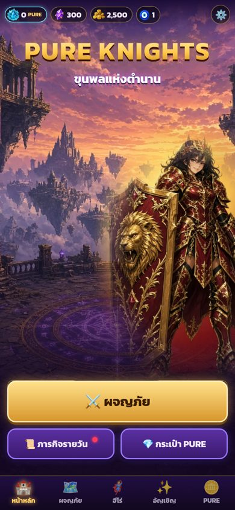
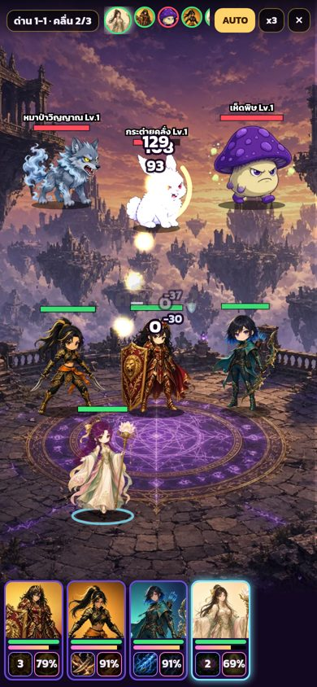
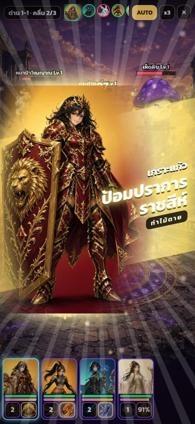
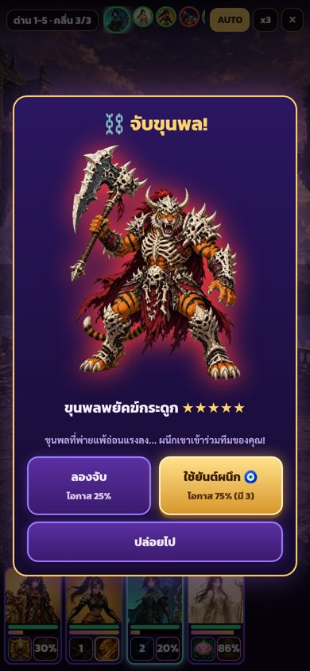

# ⚔️ PURE Knights — ขุนพลแห่งตำนาน

เกม RPG เทิร์นเบสสะสมฮีโร่บนมือถือ (แนว Seven Knights) เล่นผ่านเบราว์เซอร์ / ติดตั้งเป็นแอป (PWA) ได้ทันที — เล่นแล้วได้เหรียญ **PURE**, มีระบบ **จับขุนพล**, **ท่าไม้ตาย** พร้อมคัตอิน และ **เสียงพากย์ไทยด้วย Google Gemini**

A mobile-first, turn-based hero-collection RPG (Seven Knights style) that runs in the phone browser as an installable PWA. Earn **PURE** coins, **capture enemy generals**, fire flashy **ultimates** with cut-ins, and hear **Thai voice-over powered by Google Gemini TTS**.

**▶️ เล่นเลย / Play now: https://purefxaidev.github.io/pure-knights/**

| หน้าหลัก | ต่อสู้ | ท่าไม้ตาย | จับขุนพล |
|---|---|---|---|
|  |  |  |  |

> ⚠️ **Prototype:** PURE เป็นแต้มในเกมที่เก็บในเครื่อง (localStorage) เท่านั้น ยังไม่ใช่โทเคนจริง ไม่มีมูลค่าเป็นเงิน และยังไม่มีการเชื่อมวอลเล็ตจริง / PURE is an in-game balance stored locally. No real token, no real money, no wallet connection yet.

---

## 🇹🇭 วิธีเล่น

1. เปิดลิงก์บนมือถือ (แนวตั้ง) → กด **⚔️ ผจญภัย**
2. เลือกด่านบนแผนที่ (3 บท × 5 ด่าน) → **เริ่มต่อสู้**
3. ทีม 5 ฮีโร่ สู้กับศัตรู 3 คลื่น ลำดับเทิร์นตามค่าความเร็ว (แถบด้านบน)
   - แตะปุ่ม **สกิล** (ซ้าย) เพื่อจองคิวสกิล — ใช้ในเทิร์นถัดไปของฮีโร่ตัวนั้น (ตัวเลขบนปุ่ม = ลำดับคิว)
   - เมื่อพลังเต็ม 100% ปุ่ม **ท่าไม้ตาย** (ขวา) จะเรืองแสง → แตะเพื่อปล่อยท่าไม้ตาย พร้อมคัตอินตัวละคร แฟลชหน้าจอ และเสียงพากย์
   - **AUTO** = ให้ AI เล่นเอง, **x1/x2/x3** = ความเร็ว
4. ชนะแล้วได้ **PURE 🪙**, ทอง 💰, เพชร 💎 (เคลียร์ครั้งแรกได้ PURE x2) — เพดาน 60 PURE/วัน
5. **⛓️ จับขุนพล:** ด่าน 1-5, 2-5, 3-5 มีขุนพลศัตรู (พยัคฆ์กระดูก / ราชินีราตรี / จอมมารโลหิต) ชนะแล้วเลือก "ลองจับ" (25%) หรือใช้ **ยันต์ผนึก 🧿** (75%) จับสำเร็จขุนพลจะเข้าร่วมทีม จับซ้ำได้ชิ้นส่วนไว้เลื่อนดาว (ล้มเหลวเล่นด่านซ้ำได้)
6. **✨ อัญเชิญ** ฮีโร่ใหม่ด้วยเพชร (x1 = 100, x10 = 900) — ได้ซ้ำเป็นชิ้นส่วน
7. **🦸 ฮีโร่:** อัปเลเวลด้วยทอง, เลื่อนดาวด้วยชิ้นส่วน, จัดทีม/หัวหน้าทีม, ฟังเสียงตัวละคร
8. **📜 ภารกิจรายวัน** รับ PURE, เพชร และยันต์ผนึก · **🪙 กระเป๋า PURE** ดูยอด ประวัติ ตั้งที่อยู่วอลเล็ต (ระบบถอน/เชื่อมวอลเล็ต = เร็วๆ นี้)

### 🎙️ ใส่ Gemini API key (ฟรี)
1. ไปที่ https://aistudio.google.com/apikey → สร้าง API key (ใช้ free tier ได้)
2. ในเกมกด **⚙️ ตั้งค่า** → วางคีย์ในช่อง *Gemini API key* → **บันทึก** → **🔊 ทดสอบเสียง**
3. คีย์ถูกเก็บใน `localStorage` ของเครื่องคุณเท่านั้น และส่งตรงไปที่ `generativelanguage.googleapis.com` — ไม่มีเซิร์ฟเวอร์กลาง ไม่ฝังคีย์ในโค้ด
4. ถ้าไม่ใส่คีย์: ฮีโร่ดั้งเดิมใช้เสียงที่อัดไว้แล้ว (สร้างด้วย Gemini TTS) และบทพูดอื่นใช้เสียงภาษาไทยของเบราว์เซอร์ (SpeechSynthesis `th-TH`)

### 📲 ติดตั้งเป็นแอป
Android (Chrome): เมนู ⋮ → *ติดตั้งแอป* · iPhone (Safari): แชร์ → *เพิ่มไปยังหน้าจอโฮม*

---

## 🇬🇧 How to play

1. Open the link on your phone (portrait) → **⚔️ ผจญภัย (Adventure)**.
2. Pick a stage on the campaign map (3 chapters × 5 stages) → **Fight**.
3. 5 heroes vs 3 enemy waves; turn order is by speed (strip at the top).
   - Tap a hero's **skill** button to queue it for that hero's next turn (number = queue order).
   - At 100% energy the **ultimate** button glows → tap to unleash it with a character cut-in, screen flash, particles, Thai skill name and voice line.
   - **AUTO** lets the AI play; **x1/x2/x3** changes speed.
4. Wins pay **PURE**, gold and gems (first clear pays double PURE; 60 PURE/day cap).
5. **General capture (จับขุนพล):** stages 1-5, 2-5, 3-5 feature an enemy General. After winning, try a free capture (25%) or use a **Seal Talisman 🧿** (75%). Captured generals join your roster; duplicates become star-up shards. Failed? Replay the stage.
6. **Summon** heroes with gems; **Heroes** screen to level up (gold), star up (shards), set team/leader; **Daily quests**; **PURE wallet** with balance, history, saved address, withdraw/connect placeholders.

### Adding your Gemini key
Get a free key at https://aistudio.google.com/apikey → in game **⚙️ Settings** → paste → **Save** → **Test voice**. The key lives only in your browser's `localStorage` and is sent only to Google's API. Without a key the game uses pre-recorded Gemini voice lines plus the browser's Thai `SpeechSynthesis` voice. TTS model is configurable (default `gemini-2.5-flash-preview-tts`).

## 🛠️ Tech
- Plain HTML5 Canvas + vanilla JS, no build step, no paid services. PWA (manifest + service worker, offline asset cache).
- Files: `js/data.js` (heroes/generals/stages), `js/battle.js` (turn engine + renderer + FX), `js/voice.js` (Gemini TTS / fallbacks / synth SFX), `js/game.js` (screens, save, economy, capture).
- Art: AI-generated anime art (heroes, generals, monsters, backgrounds) by PureFxAi. `tools/process.py` keys chroma backgrounds into game sprites.
- Run locally: `python3 -m http.server` → open `http://localhost:8000`. Headless test: `python3 tests/play.py http://localhost:8000/` (Playwright).

## 🗺️ Roadmap
- Real PURE token on Base + wallet connect & withdraw (with server-side anti-cheat — local balances can be edited by players)
- Gemini Live real-time narrator, more chapters, PvP arena, guild, equipment

## 💖 Donate / สนับสนุนผู้พัฒนา
ถ้าชอบเกมนี้ ร่วมสนับสนุน PureFxAi ได้ที่ / If you enjoy the game, support PureFxAi:

**USDT (ERC20):** `0x920deab53daf94ca2030ad5ceec2265bf5686941`

⚠️ ส่งเฉพาะ USDT บนเครือข่าย Ethereum (ERC20) เท่านั้น / Send only USDT on Ethereum (ERC20).

---
MIT License · © 2026 PureFxAi
